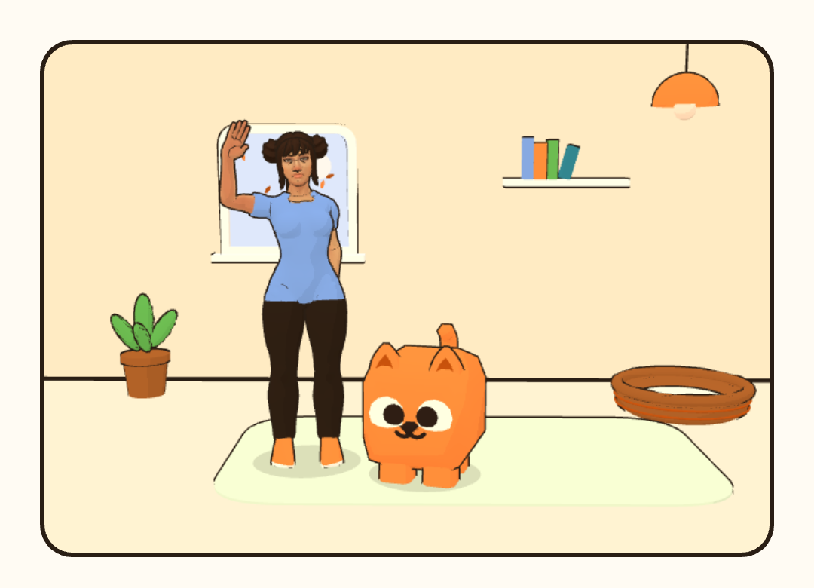
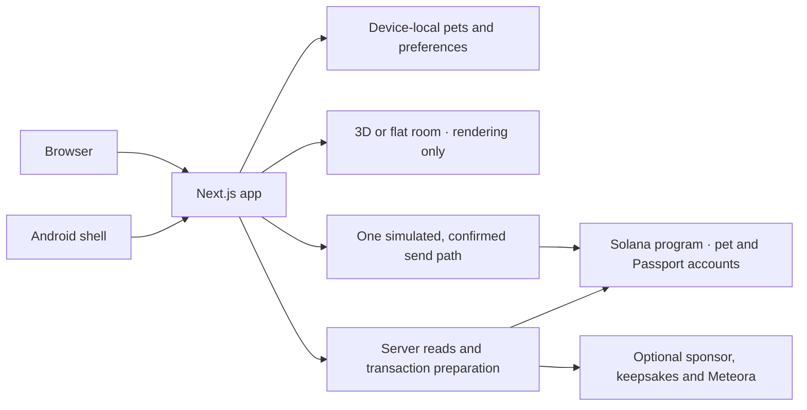

<p align="center">
  
</p>

<h1 align="center">Pawket</h1>

<p align="center"><strong>A little companion. A room of your own. A reason to come back.</strong></p>

<p align="center">
  Adopt a luna cat, a moss pup or a cloud bun.<br>
  Care for them, find their look, and make a little history together.<br>
  No account. No wallet needed to play.
</p>

<p align="center">
  <a href="https://pawket.world/adopt"><strong>Bring a pet home</strong></a>
  &nbsp; / &nbsp;
  <a href="docs/PLAYING.md">Player guide</a>
  &nbsp; / &nbsp;
  <a href="#run-it-locally">Run locally</a>
  &nbsp; / &nbsp;
  <a href="docs/README.md">Documentation</a>
</p>



<p align="center"><sub>You and your companion, at home. Captured with Pawket's Photo tool.</sub></p>

## Small rituals, plenty of personality

Pawket is a web-first companion game for people who want a pet to check in on,
not another economy to keep up with. It runs in the browser and in an Android
shell around the same app. Start with a name and a temperament; come back for
a meal, a game, a new coat, or just a hello.

- **A companion, not a countdown.** Feed, play, brush and rest. Care earns XP,
  levels, streaks and stickers. Needs drift between visits, but there is no
  death state.
- **A room that feels like yours.** Share a 3D room with your pet, arrange its
  things, change your own look, play an emote and take a photo. Prefer flat
  art? Switch to 2D; care works either way.
- **Four games, one fair daily round.** Catch, Hop, Copy and Pairs share daily
  seeds. Practice freely. The daily XP bonus is flat: a purchase, a coin or a
  better score cannot buy more progress.
- **Expression without an advantage.** Free coats, starter pieces and room
  things sit alongside optional fixed-price Market looks. Nothing bought
  changes vitals, XP, cooldowns or scores.
- **History you can share, if you choose.** Solana adds public Passports,
  visit rooms, guestbook waves and a frozen keepsake card. Guilds bring pets
  together through events and polls; joining does not require a guild coin.
- **The same home on your phone.** Android adds wallet-app integration,
  gallery and native sharing, calendar reminders, haptics and App Links—not
  a separate game or a second signing path.

## Start local. Choose Solana later.

The complete local care-and-play loop is free and wallet-free. Browser pets
stay in that browser; Android pets stay in the app's storage. Use
**Profile → Pets → Keep a copy** before clearing data or switching browsers.

Solana is optional and defaults to **devnet**. Keeping a pet there creates a
**new record** with its name, species and temperament—not an import of its
local XP or history. The [player guide](docs/PLAYING.md#choose-solana-if-you-want-to)
explains setup and what carries across devices.

App transactions require a linked **Pawket Wallet**. Its non-extractable
device key can sign permitted non-money actions within limits the owner sets;
the owner approves setup and spending. While sponsorship is available, Pawket
pays eligible devnet fees and rent. Market purchases and coins still spend
SOL from Pawket Wallet. Without sponsorship, eligible actions use a device fee
float and rent-bearing actions wait.

**Pets are not for sale.** Looks have no resale market. A keepsake is a card,
not a transferable pet. Guild coins are optional, isolated from care, and can
lose all value. Mainnet is not released; [its gates](docs/MAINNET.md) are
separate from what works on devnet.

## Run it locally

You only need Node and pnpm for local play. No wallet, RPC credential,
Solana toolchain or Android SDK is needed to start.

```sh
git clone https://github.com/0xuser64bit/pawket.git
cd pawket
nvm install                         # use .nvmrc (or install that Node version yourself)
nvm use
npm install --global pnpm@10.34.6    # package.json pins the package manager
cp -n .env.example .env.local       # preserve an existing local configuration
pnpm install --frozen-lockfile
pnpm dev
```

Open [localhost:3000](http://localhost:3000), choose **Adopt a pet**, take them
home and try **Feed**. Open **Playground** for a round. Local care and your pet
should survive a reload. Public discovery needs working devnet RPC; a failed
chain read does not prevent local play.

Already set up? See [development](docs/DEVELOPMENT.md) for another port,
configuration, troubleshooting and deployment boundaries.

```sh
pnpm verify                        # typecheck → lint → unit tests → production build
pnpm exec playwright install chromium
pnpm e2e                           # browser flows; no signing by default
```

Program, Android and opt-in devnet checks have additional prerequisites and
effects. Use the [testing guide](docs/TESTING.md) rather than treating the web
gate as proof of every platform.

## Built around one source of truth

**Next.js + React + TypeScript** for the app, **React Three Fiber + Three.js**
for the room, **Anchor/Rust** for the Solana program, **Solana Kit** for the
shared wallet/send path, and **Kotlin/WebView** for Android. Exact versions
live in the build files, not a second dependency list here.



There is no application database, server account system or indexer. Local
play and chain care replay the same game-math fixture. Solana records are
re-read after confirmation rather than optimistically replaced; the room
cannot write pet state.
Server-only secrets never belong in the browser or Android bridge.

| Find your layer | Start here |
| --- | --- |
| Screens, routes and shared UI | `app/`, `src/components/pk/` · [route map](docs/ROUTES.md), [design system](docs/DESIGN.md) |
| Care, local pets and games | `src/lib/game/`, `src/lib/guest/`, `src/lib/play/` · [game rules](docs/GAME-DESIGN.md) |
| Wallets and program | `src/lib/solana/`, `src/lib/wallet/`, `programs/pawket/` · [Solana guide](docs/SOLANA.md) |
| 3D assets and renderer | `scripts/3d/`, `src/components/room3d/` · [room pipeline](docs/ROOM-3D.md) |
| Native shell | `android/` · [Android build and release](docs/ANDROID.md) |

The [architecture guide](docs/ARCHITECTURE.md) explains persistence, trust
boundaries and the transaction lifecycle. [AGENTS.md](AGENTS.md) maps exact
facts to their authoritative files.

## Make yourself at home

- **Playing?** Start with the [player guide](docs/PLAYING.md): first visit,
  pet copies, Solana setup and common problems.
- **Contributing?** Read [CONTRIBUTING.md](CONTRIBUTING.md), then the
  [workflow](docs/WORKFLOW.md). Work on `dev`; development PRs target `dev`.
  Releases from `dev` to `main` require explicit authorization.
- **Exploring the decisions?** Read the [product](docs/PRODUCT.md),
  [direction](docs/VISION.md) and [accepted decisions](docs/DECISIONS.md).
- **Running a deployment?** Start with [environment](docs/ENVIRONMENT.md),
  [development and releases](docs/DEVELOPMENT.md) and
  [security boundaries](docs/SECURITY.md).

Questions and player support: [hi@pawket.world](mailto:hi@pawket.world).
Report vulnerabilities [privately](SECURITY.md), not in a public issue.

---

[MIT](LICENSE) for the source. Pets by [Kenney](https://kenney.nl/assets/cube-pets),
characters by [Quaternius](https://quaternius.com/packs/universalbasecharacters.html).
Fonts and bundled assets keep their own [licenses and notices](THIRD_PARTY_NOTICES.md).
